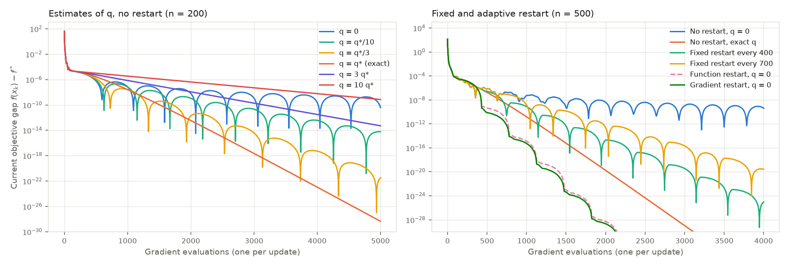
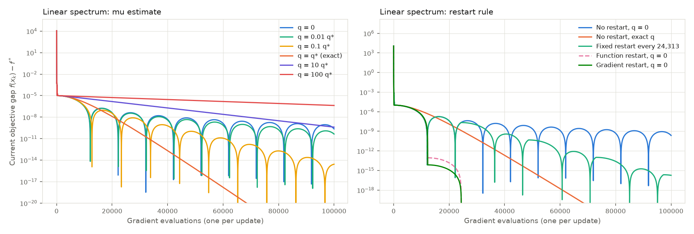
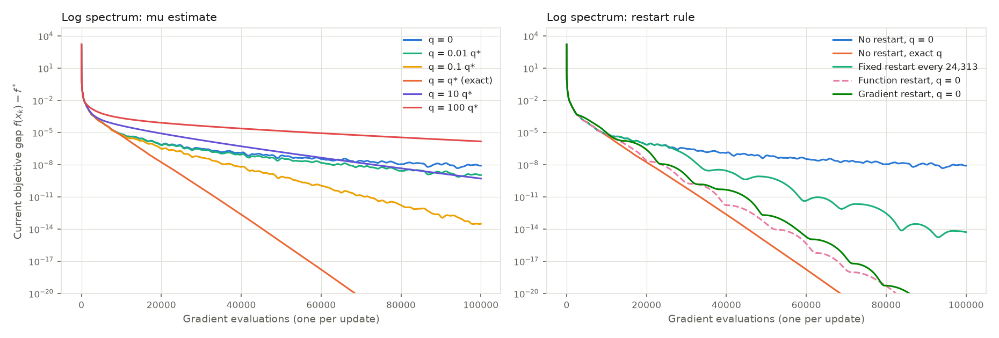

# Restarted AGD: summary of the assigned work

Kwonsang's stream, run November 22, 2026. Scope follows the
[group handoff](../CONTRIBUTING.md): inspect the existing gradient restart, add
function restart, reproduce one O'Donoghue–Candès example, and report restart and
mu sensitivity. Everything here is new course work; no frozen historical code or
result was changed.

**Read this first.** Each case below is one problem instance with one start. The
runs used Python 3.12.16, not the project's pinned 3.13. The 100,000-update budget
and the targets are provisional until the group freezes them. Nothing here
supports a general claim about restart.

**Integration review, November 23:** the finite trajectories and cost counters
were checked bitwise against the submitted implementation on 24 bounded cases.
Failure handling now rejects invalid initial/extrapolated states, preserves paid
failed work, and prevents failed runs from claiming sustained targets. Input
hashes and allocation/smoke guards were added. The original result tables and
three submitted PNGs below are carried forward from Kwonsang's laptop study;
the full 100,000-update sensitivity sweep was not rerun during this review.

## Status of the assigned tasks

| Task | Status | Evidence |
| --- | --- | --- |
| Inspect the existing gradient restart | Done | New code reproduces `core.ar_step` restart locations exactly and losses to a relative 1e-8; on both fixtures it reproduces the historical 11,832 and 25,188 gradient counts |
| Add function-increase restart | Done | `src/stat605/agd.py`, conventions below, tests in `tests/test_stat605_agd.py` |
| Reproduce one O'Donoghue–Candès example | Qualitative only | The paper does not state its matrices, starts or iteration counts, so array-level agreement is not possible |
| Restart and mu sensitivity | Done for two fixtures, one instance each | Tables and figures below |
| Shared-harness adapter, logistic validation, report subsection | Not started | Waiting on the group's common settings |

## Method and declared conventions

The scheme is Algorithm 1 of O'Donoghue and Candès (arXiv:1204.3982), with step
`eta = 1/L` and a parameter `q` in [0, 1]:

```
x_k     = y_{k-1} - eta * grad f(y_{k-1})
theta_k   solves  theta_k^2 = (1 - theta_k) * theta_{k-1}^2 + q * theta_k
beta_k  = theta_{k-1} * (1 - theta_{k-1}) / (theta_{k-1}^2 + theta_k)
y_k     = x_k + beta_k * (x_k - x_{k-1})
```

`q = 0` uses no mu, `q = q* = mu/L` is the strongly convex choice, and `q = 1` is
gradient descent. The two adaptive rules are the paper's:

This variable-theta scheme is Algorithm 1. The historical strongly-convex AGD
baseline uses the paper's constant-momentum Algorithm 2, so their exact-mu target
counts need not match. The q=0 gradient-restart methods are compared separately.

- **Function restart:** restart when `f(x_k) > f(x_{k-1})`.
- **Gradient restart:** restart when `grad f(y_{k-1})^T (x_k - x_{k-1}) > 0`.

The paper gives no pseudocode for the adaptive rules. These conventions are our
reading of its fixed-restart scheme:

- Both inequalities are strict; equality does not restart.
- The new point `x_k` is kept even when the objective increased, so function
  restart is not a monotone method.
- A restart sets `y_k = x_k` and `theta_k = 1`, which makes the next update a plain
  gradient step.
- Every rule costs one gradient per update. Function restart also costs one
  objective evaluation per update. Gradient restart costs one extra dot product.

All counts below are gradient evaluations, which equal updates. "First" is the
first update with gap at or below the target. "Sustained" is the update from which
the gap stays at or below the target through the end of the run; it says nothing
about later updates. "Not reached" entries are censored, not omitted.

## 1. Source-style replication



The primary PDF shows Figure 1 at n = 200 with `q* = 4.1e-5`, its q-value legend,
and an axis extending to 5,000 iterations. Figure 3 uses n = 500, discusses fixed
intervals 400 and 700, and displays up to 2,000 iterations. We chose a seeded
linear spectrum and Gaussian start; our 4,000-update Figure 3-style run extends
that displayed range. The Figure 3 condition number (8,289) is back-calculated from
`e * sqrt(8 * kappa) = 700`. The lower axis limit is clipped at 1e-30.

**Estimates of q (left, n = 200).**

| q | First 1e-8 | Sustained 1e-8 |
| --- | ---: | ---: |
| 0 | 582 | 2,423 |
| q*/10 | 610 | 1,482 |
| q*/3 | 692 | 1,110 |
| q* (exact) | 1,091 | 1,091 |
| 3 q* | 2,035 | 2,035 |
| 10 q* | 3,756 | 3,756 |

- Underestimating `q` reaches the target early and then rebounds above it. The
  curves ripple, and the ripples grow as `q` falls to 0.
- Overestimating `q` is monotone but slow: 3× costs about 1.9× the exact count and
  10× about 3.4×.
- This matches the paper's description of its Figure 1: ripples below `q*`,
  monotone slow convergence above it.

**Fixed and adaptive restart (right, n = 500).**

| Method | First 1e-8 | Sustained 1e-8 | Restarts in 4,000 updates |
| --- | ---: | ---: | ---: |
| Gradient restart, q = 0 | 425 | 425 | 12 |
| Function restart, q = 0 | 427 | 427 | 12 |
| No restart, exact q | 663 | 663 | 0 |
| Fixed restart every 400 | 688 | 688 | 10 |
| Fixed restart every 700 | 627 | 942 | 5 |
| No restart, q = 0 | 627 | 1,695 | 0 |

- Both adaptive rules are on the order of exact `q` (here somewhat faster) and
  ahead of both fixed intervals, as the paper reports for its Figure 3.
- The paper says interval 400 performs about as well as 700. Here 400 is clearly
  better on the sustained count. This is a difference on our matrix; it cannot be
  attributed to the paper's problem.
- After the first restart near update 86, the adaptive rules restart every 348 or
  349 updates, about 3.8 times `sqrt(kappa)`.

**Verdict.** The qualitative ordering of the paper's two figures is reproduced on
a problem of the stated size. This is not source parity.

## 2. Sensitivity on the shared fixtures

Both fixtures have d = 100, mu = 5e-5, L = 500, `q* = 1e-7`, the historical start,
and `eta = 0.002`. Each run has 100,000 updates. The lower axis limit is clipped at
1e-20; the adaptive-restart curves continue far below it.

### Linear spectrum (`quadratic_paper.npz`)



| Method | First 1e-8 | Sustained 1e-8 | Restarts |
| --- | ---: | ---: | ---: |
| Function restart, q = 0 | 11,787 | 11,787 | 11 |
| Gradient restart, q = 0 | 11,832 | 11,832 | 12 |
| No restart, q = q* | 20,466 | 20,466 | 0 |
| Gradient restart, q = q* | 20,634 | 20,634 | 4 |
| No restart, q = 0.1 q* | 12,203 | 21,443 | 0 |
| Fixed restart every 24,313, q = 0 | 11,664 | 29,710 | 4 |
| No restart, q = 0.01 q* | 11,715 | 38,051 | 0 |
| No restart, q = 0 | 11,664 | 38,895 | 0 |
| No restart, q = 10 q* | 68,726 | 68,726 | 0 |
| No restart, q = 100 q* | not reached | not reached | 0 |

### Log spectrum (`quadratic_log.npz`)



| Method | First 1e-8 | Sustained 1e-8 | Restarts |
| --- | ---: | ---: | ---: |
| No restart, q = q* | 20,996 | 20,996 | 0 |
| Gradient restart, q = q* | 20,996 | 20,996 | 0 |
| Function restart, q = 0 | 23,866 | 23,866 | 9 |
| Gradient restart, q = 0 | 25,188 | 25,188 | 9 |
| Fixed restart every 24,313, q = 0 | 32,902 | 32,902 | 4 |
| No restart, q = 0.1 q* | 37,742 | 37,742 | 0 |
| No restart, q = 0.01 q* | 62,627 | 66,803 | 0 |
| No restart, q = 10 q* | 73,076 | 73,076 | 0 |
| No restart, q = 0 | 86,043 | 98,813 | 0 |
| No restart, q = 100 q* | not reached | not reached | 0 |

The `q = 0` sustained count on the log spectrum (98,813) sits near the end of the
budget, so it is weak evidence that the gap would stay below the target.

### What the numbers show

- **Agreement with the inherited result.** Gradient restart with `q = 0` gives
  11,832 and 25,188, identical to the historical gradient-restart AGD counts in
  [the status audit](PROJECT_STATUS.md). The new implementation is consistent with
  the old one on the shared problems.
- **The two adaptive rules are close.** Function restart is ahead by 45 gradients
  on the linear spectrum and 1,322 on the log spectrum. Its controller requires
  objective values, while gradient restart uses a dot product. This runner pays
  for diagnostic objectives for every rule, so the actual objective counts and
  required controller counts must remain distinct. Gradient counts alone do not
  establish an overall cost or runtime ranking.
- **Overestimating mu is costly and restart does not repair it.** A 10× overestimate
  costs 3.4× (linear) and 3.5× (log) the exact count; 100× does not reach 1e-8 in
  the budget. With `q` at or above `q*` the restart tests fire at most four times
  (all in the first 170 updates) and the counts barely move.
- **Underestimating mu hides behind first crossings.** On the linear spectrum
  `q = 0` first touches 1e-8 at 11,664 but stays below only from 38,895. Reporting
  first crossings alone would rank it level with adaptive restart.
- **Adaptive restart removes the need for mu when `q` is underestimated.** With
  `q = 0` or `0.01 q*`, both rules reach the sustained target within 12,000
  (linear) and 25,200 (log) gradients.
- **The ranking against exact `q` changes with the spectrum.** Adaptive restart
  needs 58% of the exact-`q` work on the linear spectrum and 114–120% on the log
  spectrum. Exact `q` is nearly unchanged (20,466 against 20,996).
- **A fixed interval at the paper's bound is a weak substitute.** It helps over no
  restart but trails both adaptive rules on both spectra.

### Interpretation (hypotheses, not verified)

- On the linear spectrum the adaptive rules restart every 12,113 or 12,114 updates,
  about 3.8 times `sqrt(kappa)`, and each restart is followed by a drop of roughly
  eleven orders of magnitude. The second-smallest eigenvalue is about 5, five orders
  above mu, so the late error is probably one slow mode, and one well-timed
  restart removes most of it.
- On the log spectrum the restart intervals are irregular (roughly 7,900 to
  14,800 updates) and each restart gains much less. Many eigenvalues lie near mu,
  with different oscillation periods, so no single restart time suits them all.
- Modal energies were not computed in these runs. Checking this explanation needs
  the per-mode diagnostics planned for the spectral study.

## Limits

- One matrix and one start per case; no repeated starts or problem draws.
- The replication matrices are our own choice, so agreement with the paper is
  qualitative.
- The original study used an HTML conversion. Integration review checked the
  recurrence, restart inequalities, and displayed figure extents against the
  [primary PDF](https://arxiv.org/pdf/1204.3982v1); no exact source-array replay is claimed.
- Python 3.12.16 and NumPy 2.5.3 on a laptop, one BLAS thread. Timing was not
  analysed; wall time includes the per-update objective evaluation for every rule.
- Chart colours were taken from a standard palette; the colour-blindness check
  could not be run on this machine.

## Reproduce

The contributor's original raw traces are under `tmp/agd-odonoghue-20261122/` and
`tmp/agd-sensitivity-20261122/` on that machine and are not included in Git.
Those runs wrote `summary.json` with the config, hashes and crossings.
For a bounded software check on the shared inputs, from bash:

```bash
source scripts/activate_env.sh
python -m pytest tests/test_stat605_agd.py
python scripts/stat605.py agd --smoke --config configs/stat605/agd_smoke.json --output tmp/agd-smoke
```

The smoke command caps work at 2,000 gradients total and dimension 100. Full
configured runs require an active Slurm allocation; then use new output paths:

```bash
python scripts/stat605.py agd --config configs/stat605/agd_odonoghue.json --output tmp/<new-dir-1>
python scripts/stat605.py agd --config configs/stat605/agd_sensitivity.json --output tmp/<new-dir-2>
python scripts/plot_agd_summary.py --replication tmp/<new-dir-1> --sensitivity tmp/<new-dir-2> --output tmp/<new-figure-dir>
```

The contributor reported about 2 and 40 seconds on the laptop; those are not
Grace allocation estimates or matched optimizer timings. Existing figure output
directories are refused so the submitted PNGs are not overwritten.

## Open items for the group

- Freeze the common start, budget, targets and output fields, then rerun under them.
- Rerun final matched experiments in the pinned Python 3.13 environment and
  retain the original laptop study as separately identified evidence.
- Agree a storage location for raw traces.
- Add modal diagnostics to test the spectrum explanation above.
