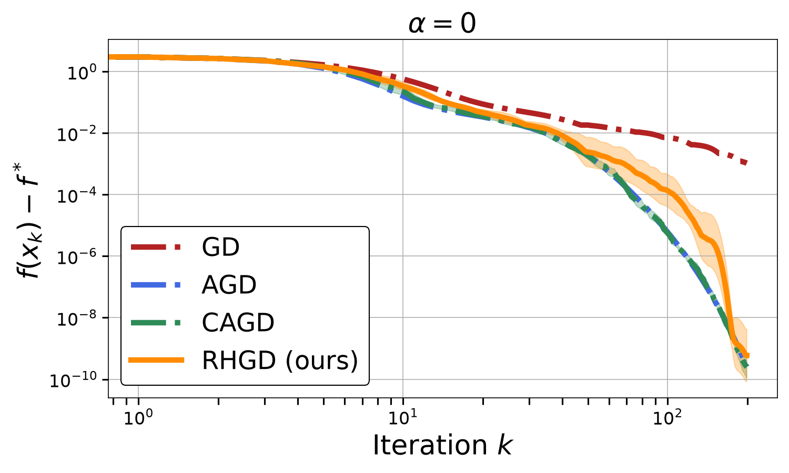

# Inherited evidence

These are small byte-identical copies of retained historical artifacts, copied
November 12, 2026. No optimizer was rerun to create them. [PROVENANCE.json](PROVENANCE.json)
records original relative paths, byte sizes, and SHA-256 hashes. Full raw arrays
are not in the shared source bundle; coordinate group storage separately.

| File | Meaning |
| --- | --- |
| `fig1-*-parity.json`, `fig2-*-parity.json` | Five same-environment direct-author parity checks |
| `spectral-summary.json` | Fair-cost linear/log spectral study, run 19819633 |
| `spectral-validation.json` | Historical cache/path/cost checks for that study |
| `power-reset-summary.json` | Earlier frozen B study, run 19819175; literal-call accounting |
| `power-reset-verification.json` | Historical B artifact verification receipt |
| `rhgd-logistic-replay.png` | Saved Figure 2-right source replay, run 19734521 |

Do not compare timings across these separate studies as if they were matched.
The fair spectral study is the relevant test against gradient-restart AGD.
The earlier B study's larger literal-call advantage includes duplicate baseline
calls. Neither file makes a universal performance or novelty claim.

Figure 1-right is a requested million-step extension, not the notebook's default
10,000-step replay. NaN/Inf equality positions in its parity receipt preserve the
author's near-floor plotting behavior. Parity verifies replay fidelity, not exact
agreement with unavailable original published arrays.

This historical figure retains author plotting/statistical conventions. Use the
[status audit](../PROJECT_STATUS.md) for what it can and cannot establish.
