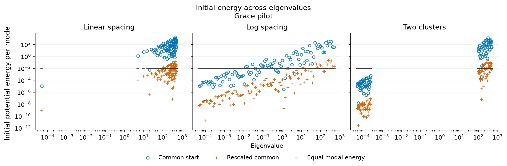
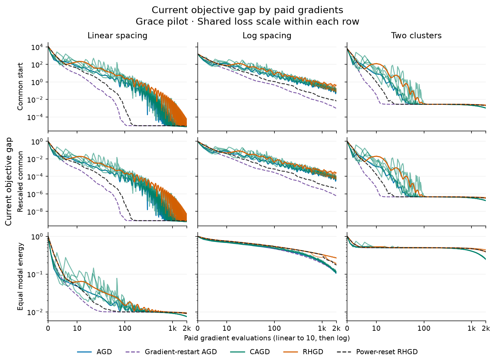

# How spectral geometry and starting energy affect momentum resets

Leo Oh · STAT 605 · November 22, 2026

On a strongly convex quadratic, how much does a restart method’s performance depend on the curvature of the problem, and how much on where the initial error lies? We compared five methods on three 100-dimensional quadratics with the same condition number. At an initial objective of one, 36 of 39 paths sustained a gap of $10^{-4}$ when we kept the original proportions of energy in each direction. After we gave every direction equal energy, none of the 39 matched paths reached that target within 2,000 gradient evaluations. Even with energy held equal, every method and seed finished with its smallest gap on the linear spectrum and its largest on the clustered spectrum.

## Matched problems and starting conditions

For $f(x)=\tfrac12 x^\top A x$, the minimum is $f(0)=0$. Write $A=Q\,\mathrm{diag}(\lambda_i)\,Q^\top$ and $z=Q^\top x$. Mode $i$ contributes $E_i=\lambda_i z_i^2/2$ to the objective. Reusing a starting vector across spectra keeps its coordinates $z_i$ fixed when the basis is shared. Changing the eigenvalues still changes the total loss and each mode’s share of it.

All three matrices share the same basis, dimension, and extreme eigenvalues, $\mu=5\times10^{-5}$ and $L=500$, giving a condition number of $10^7$. We used the retained linear and log-spaced matrices. For the clustered matrix we placed 50 eigenvalues across each outer tenth of the log-curvature interval, equally spaced in log curvature within each band.

| Spectrum | Original starting loss | Share of loss in the 50 slowest modes |
| --- | ---: | ---: |
| Linear | 11,362.68 | 24.85% |
| Log-spaced | 1,594.04 | 0.04163% |
| Two clusters | 6,101.85 | 0.00004634% |

The **common** start retains the original vector for historical comparison. The **rescaled common** start multiplies that vector by a scalar to set $f(x_0)=1$, preserving the shares in the table. The **equal-energy** start keeps the same modal signs and sets $|z_i|=\sqrt{2/(100\lambda_i)}$, giving each mode 0.01 and the slowest half 50% of the loss. Comparing these last two starts within a matrix holds total initial loss fixed. Comparing equal-energy starts across matrices holds all 100 initial modal energies fixed.



**Figure 1.** Each mark represents one eigendirection. Rescaling shifts the common-start energies vertically. Equal allocation makes the starting energy independent of curvature.

## Work to reach and sustain the targets

Grace job `20654076` ran AGD with known $\mu$, gradient-restart AGD, continuized AGD (CAGD), original randomized Hamiltonian gradient descent (RHGD), and power-reset RHGD. Within each of nine spectrum/start combinations we ran each deterministic method once and each randomized method with five fixed algorithm seeds, paired across problems. All 117 paths completed 2,000 paid gradient evaluations, with zero rejected updates or numerical failures. We used $\eta=1/L=0.002$ and $h=\sqrt{\eta}$ for the two RHGD methods. Both used the same position and velocity update. Their reset rules differed. [Configuration](../../configs/stat605/spectral_pilot.json) · [Method conventions](../METHODS.md)

A **first** hit is the first recorded current loss at or below the target. A **sustained** hit is the first such point after which the current loss stays below or equal to the target through the final update. An unreached target is censored at the budget. The table gives paid gradients to sustain $10^{-4}$ for the **rescaled common** start. CAGD and original RHGD entries are medians over all five seeds, with misses ranked after hits. All five seeds hit the target wherever a randomized method has a numerical entry.

| Spectrum | AGD | Gradient-restart AGD | CAGD | Original RHGD | Power-reset RHGD |
| --- | ---: | ---: | ---: | ---: | ---: |
| Linear | 94 | 18 | 165 | 190 | 34 |
| Log-spaced | 1,477 | 163 | 1,885 | Censored (2/5 hit) | 302 |
| Two clusters | 21 | 7 | 23 | 44 | 12 |

Gradient-restart AGD reached this target in the fewest gradients on all three rescaled-common cases. Among the two RHGD rules, power reset reduced the sustained work from a median of 190 to 34 on linear and from 44 to 12 on clustered. On log, power reset used 302 gradients and only two original RHGD paths sustained the target. Switching to equal energy removed every first and sustained hit across all three spectra, even though the same methods started at the same total loss of one.

With the **original common** start, all 13 linear paths sustained $10^{-4}$ and none of the 26 log or clustered paths reached it. Those three starts have different absolute losses (Figure 1). Across the whole pilot, 49/117 paths sustained $10^{-4}$ and 13/117 sustained $10^{-8}$. All 13 tighter-target hits came from the rescaled linear problem. For original RHGD on that problem, the median first hit at $10^{-8}$ took 910 gradients and the median sustained hit took 1,824. [All work-to-target results](grace-20654076/work_to_target.csv) · [Per-path crossings](grace-20654076/targets.csv)

## What remained after 2,000 gradients

With every equal-energy path censored, the **current objective after 2,000 paid gradients** shows how far the methods got. The entries below are final gaps, with medians for CAGD and original RHGD. Every path started at one, so the entries also give the fraction of initial loss remaining. They are descriptive endpoints of this pilot; time to either accuracy target on these starts remains unknown.

| Equal-energy start | AGD | Gradient-restart AGD | CAGD | Original RHGD | Power-reset RHGD |
| --- | ---: | ---: | ---: | ---: | ---: |
| Linear | 0.007521 | 0.009071 | 0.007555 | 0.009032 | 0.009165 |
| Log-spaced | 0.1061 | 0.1115 | 0.1120 | 0.2653 | 0.1742 |
| Two clusters | 0.2456 | 0.3898 | 0.2483 | 0.3870 | 0.3892 |

All 13 matched method/seed combinations had their lowest final loss on linear and their highest on clustered. Power-reset RHGD illustrates the size of the difference. It retained about 0.92%, 17.4%, and 38.9% of the initial loss, respectively. Projecting its saved final positions onto the common basis shows where that loss remained. On linear, the single slowest mode accounted for virtually all of it. On clustered, the slowest 50 modes together accounted for virtually all of it, and the single slowest accounted for only 2.33%. The clustered design assigned half the initial energy to a band whose largest eigenvalue was only $2.51\times10^{-4}$.

The starting allocation also changed the ordering of two methods at the same budget. On the log matrix with the rescaled common start, gradient-restart AGD finished at $6.05\times10^{-7}$ and known-$\mu$ AGD at $6.71\times10^{-5}$. Equalizing energy reversed that ordering, with gaps of 0.1115 and 0.1061, respectively. Within the RHGD pair at equal energy, power reset finished below the original five-seed median on log and slightly above it on linear and clustered.



**Figure 2.** Each curve shows one run. The three spectra share a logarithmic loss scale within each row. The work axis is linear from 0 to 10 paid gradients, then logarithmic to 2,000. Both RHGD methods use two gradients per update. CAGD reuses its gradient at the repeated point. [Loss versus iterations](grace-20654076/loss_iterations.png)

## Why a change of start can move a reset

Power-reset RHGD measures $P=\nabla f(x_{k+1})^\top v_{\mathrm{pre}}$ before discarding velocity. After observing negative power in a segment, it resets on the first nonnegative value, keeping the new position. Its cap of 65,536 updates exceeds the pilot horizon. Each mode contributes a signed term to $P$, so downhill motion in some directions can offset uphill motion in others.

On the **same linear matrix**, at update 3 (six paid gradients), the rescaled-common start had slow-half power $-0.0464$ and fast-half power $+0.1529$. Their sum, $+0.1065$, triggered the first reset. At that update the equal-energy start also had positive fast-half power ($+0.2136$), but the slow half contributed $-0.7411$. The sum stayed negative ($-0.5275$), and the first reset came at update 4 (eight gradients). On the log spectrum, the first reset shifted from update 4 to update 493. The complete reset flags establish both times; per-mode power is available only for the first 100 updates. [Modal power and reset locations](grace-20654076/modal_power.png)

## Interpretation and scope

Initial energy allocation changed work materially within a fixed quadratic. Even after equalizing that allocation, the spacing of the interior eigenvalues changed the loss remaining at a common budget. The reset example shows one way the starting allocation enters the algorithm, through a sum of signed contributions that determines whether velocity is retained. These results apply to one matched basis, three spectra, the stated stepsizes, and a finite observation window. The five seeds measure algorithm randomness on each fixed problem. They do not sample five independent problems.

The earlier, longer common-start study provides a separate comparison. At a sustained gap of $10^{-8}$, power-reset RHGD used 10,000 gradients on linear versus 11,832 for gradient-restart AGD. On log it used 43,016 versus 25,188. Power reset missed that study’s 20% work-and-time improvement criterion. The present pilot measured how much the starting allocations differ and compared them at equal total loss. Its 2,000-gradient horizon leaves eventual rankings on the censored cases unresolved. [Historical evidence](../PROJECT_STATUS.md)

## Reproducing the results

The pilot used source commit `4f74df8`, Python 3.13.5, float64 and one OpenBLAS thread on Grace. It spent 234,000 paid gradient evaluations for 324,000 literal requests, and recorded 180,117 objective evaluations. The downloaded source and fixture digests match the recorded run. All first and sustained crossings were checked against the saved loss traces. The fixed-budget table uses the last entry of each trace’s `loss` array, grouped by spectrum, start and method. The earlier [eight-dimensional software check](check-work-to-target.csv) is retained separately.

The downloaded run directory is `tmp/stat605-leo/spectral-pilot-20654076` in Leo’s checkout. The original Slurm template writes to `results/stat605/spectral-pilot-20654076` on Grace by default. From the project root in Bash, rebuild the figures and target tables from the downloaded traces into a fresh output directory.

```bash
source scripts/activate_env.sh
python scripts/stat605.py spectral-report \
  --run tmp/stat605-leo/spectral-pilot-20654076 \
  --output tmp/rebuilt-grace-20654076
```
