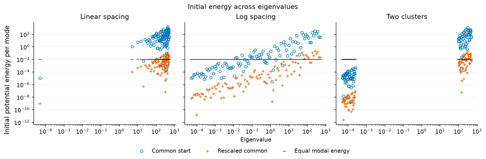
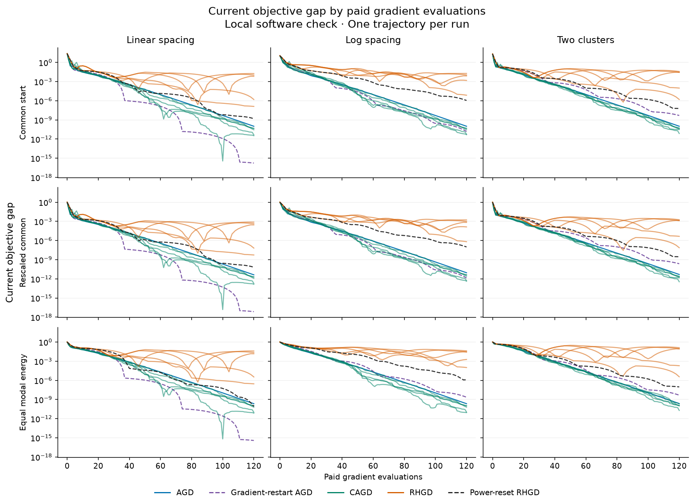

# How spectral geometry and starting energy affect a restart comparison

Leo Oh · STAT 605 · November 22, 2026

## Matched quadratics

At fixed dimension and condition number, the interior eigenvalues and the energy
initially assigned to each eigendirection can both change.
For $A=Q\,\mathrm{diag}(\lambda_i)\,Q^\top$, write $z=Q^\top x$. The potential
energy of mode $i$ is $E_i=\lambda_i z_i^2/2$, and the quadratic objective is
their sum. Reusing the same starting vector across spectra keeps $z$ fixed but
changes both the total loss and the weight of each mode.

We compared three matrices with 100 modes, minimum eigenvalue $5\times10^{-5}$
and maximum eigenvalue 500. The linear and logarithmic matrices and common
starting vector come from the shared fixtures. The clustered matrix uses the
same basis. Its 50 slow modes are equally spaced in log curvature over the
lowest tenth of the log interval. Its 50 fast modes occupy the highest tenth
by the same rule. The condition number is $10^7$ in all three cases.

| Spectrum | Common-start objective | Slowest 50 modes’ share of common-start energy | Slowest 50 modes’ share with equal modal energy |
| --- | ---: | ---: | ---: |
| Linear | 11,362.68 | 24.85% | 50% |
| Log-spaced | 1,594.04 | 0.04163% | 50% |
| Two clusters | 6,101.85 | 0.00004634% | 50% |

The clustered common start puts almost all its energy in the fast half of
the spectrum. To isolate this effect, we paired two starts at total objective
one. The first rescales the common vector and preserves its energy fractions.
The second retains its modal signs and sets $|z_i|=\sqrt{2/(100\lambda_i)}$,
giving every mode energy 0.01. Thus changing between these two starts alters
the allocation while holding the matrix and total initial loss fixed. The
original common start remains available for comparison with earlier work.



**Figure 1.** Each point is one mode at initialization. The horizontal marks
show equal energy. The two other starting conditions share a direction, so
rescaling shifts their energies vertically without changing the pattern.

## What the optimizer comparisons show

The inherited 100-dimensional common-start study found that power-reset RHGD
reached a sustained gap of $10^{-8}$ in 10,000 gradients on the linear spectrum
and 43,016 on the log spectrum. Gradient-restart AGD used 11,832 and 25,188.
The ranking reversed, and power reset missed the earlier study’s 20% work-and-time
improvement criterion. Figure 1 identifies a second difference between those
two runs. Both the spectrum and the initial modal energies changed. The old
runs alone cannot attribute the reversal to either factor. [Historical results](../PROJECT_STATUS.md)

We checked the comparison pipeline on one generated eight-dimensional basis,
with $\mu=0.05$, $L=5$ and 120 paid gradients per path. The table gives paid
gradients to reach $f(x)\leq 10^{-5}$ and stay there through the budget.
Both starts in each pair have $f(x_0)=1$. CAGD and RHGD use five algorithm
seeds on the same problem. Their entries give the median across all five.
A censored median means fewer than three paths sustained the target. The
fraction in parentheses gives the number that did.

| Spectrum | Energy allocation | AGD | Gradient-restart AGD | CAGD | Original RHGD | Power-reset RHGD |
| --- | --- | ---: | ---: | ---: | ---: | ---: |
| Linear | Rescaled common | 42 | 34 | 40 | Censored (2/5) | 42 |
| Linear | Equal | 64 | 37 | 51 | Censored (2/5) | 64 |
| Log-spaced | Rescaled common | 47 | 36 | 45 | Censored (1/5) | 74 |
| Log-spaced | Equal | 64 | 63 | 53 | Censored (0/5) | 110 |
| Two clusters | Rescaled common | 43 | 54 | 44 | Censored (2/5) | 58 |
| Two clusters | Equal | 65 | 65 | 64 | Censored (1/5) | 82 |

On the small log-spaced problem, changing only the energy allocation increased
work from 36 to 63 gradients for gradient-restart AGD and from 74 to 110
for power-reset RHGD. First and sustained crossings also gave different answers.
On the rescaled linear problem, all five original RHGD paths reached the target
at least once, with a median first crossing of 68 gradients. Only two remained
below it through the final update. These measurements describe the software
check on a single generated basis. The 100-dimensional optimizer pilot is pending.
[Complete check table](check-work-to-target.csv)



**Figure 2.** Each curve shows the current objective of one path. RHGD spends
two gradients per update. CAGD requests the same gradient twice and evaluates
it once under the shared within-update cache. The iteration plot shows how a
different horizontal axis changes the comparison. [Loss versus iterations](check-loss-iterations.png)

For the mechanism diagnostic, we record each mode’s contribution to
$\nabla f(x_{k+1})^\top v_{\mathrm{pre}}$ before power-reset RHGD clears the
velocity. Summing the products of the projected gradient and velocity gives
the controller’s scalar power. Positive and negative contributions from slow
and fast modes can cancel, so the largest initial energy need not determine
the next reset. The diagnostic figure overlays the two sums, the total, and
actual reset locations. [Modal power and resets in the software check](check-modal-power.png)

## Reproduce the figures and prepare the Grace pilot

From the project root in Bash, choose fresh output directories.

```bash
source scripts/activate_env.sh
python scripts/stat605.py spectral-design --output tmp/spectral-design
python scripts/stat605.py spectral --output tmp/spectral-check
python scripts/stat605.py spectral-report --run tmp/spectral-check --output tmp/spectral-rebuilt
```

`spectral-design` measures the 100-dimensional inputs without taking optimizer
steps. `spectral` defaults to the eight-dimensional check. `spectral-report`
rebuilds figures and both CSVs from saved results. The per-run table
(`targets.csv`) distinguishes first hits, sustained hits, budget censoring and
failures. The grouped table (`work_to_target.csv`) retains every seed in its
denominator. A failed path can contribute a first hit but cannot certify a
sustained hit through budget.

The proposed Grace pilot covers 3 spectra × 3 starts × 13 method/seed paths.
It budgets 2,000 paid gradients per path, at most 234,000 total, and tracks
absolute gaps $10^{-4}$ and $10^{-8}$. Its step is $\eta=1/L=0.002$ for
the gradient methods and $h=\sqrt{\eta}$ for RHGD. Methods using $\mu$ receive
the true value. The power-reset cap is 65,536 updates. Five fixed seeds per
randomized method are paired across cases. Power-reset RHGD records per-mode
power for the first 100 updates of each case. Use the pilot to assess cost
and censoring before freezing a full-study budget and targets.
[Pilot configuration](../../configs/stat605/spectral_pilot.json)

The job template requests one CPU, 2 GB, and 20 minutes on Grace. Check
`myproject` and `sinfo` on Grace for a valid account and partition. Once the
group has chosen a raw-output location, set `SPECTRAL_OUTPUT` to a fresh path
there if desired. From the repository root, after filling in the verified
account and partition, the submission command is

```bash
sbatch --account="$GRACE_ACCOUNT" --partition="$GRACE_PARTITION" scripts/stat605_spectral_pilot.slurm
```

The default output directory is `results/stat605/spectral-pilot-<job-id>`.
Each run records its config, seeds, input and source hashes, runtime, Slurm
metadata, raw traces and target summaries. Optimizer time includes controller
work and random draws. Endpoint loss, health checks and modal projections
are timed separately. Counts include all objective evaluations, literal gradient
requests and actually evaluated gradients, including work spent on failed updates.
Include the method owners’ additional adapters once their checks are complete.
[Environment and allocation guide](../grace.md)
